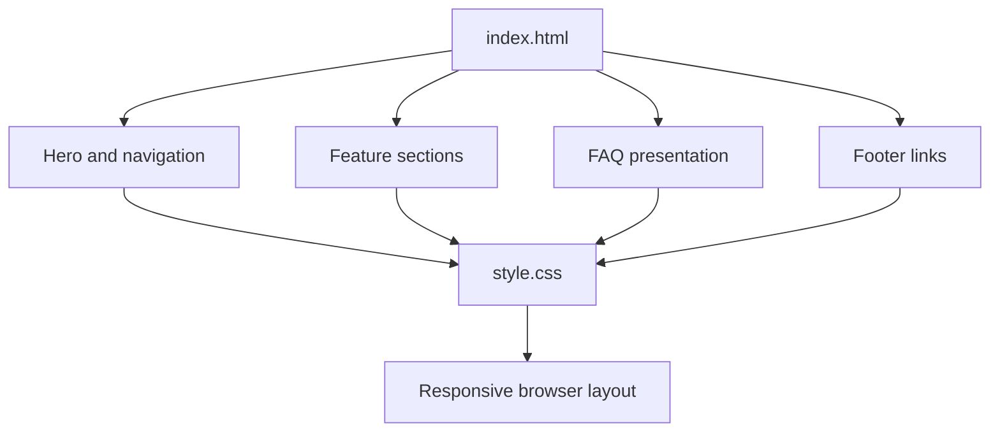

# Netflix Landing Page UI Recreation

An educational front-end recreation of a Netflix-style streaming landing page, built with plain HTML and CSS. The page demonstrates a dark hero section, navigation, feature sections, FAQ-style rows, and responsive layout styling.

<p align="center">
  
  
  
  
</p>

> This is an independent learning project. It is not affiliated with, endorsed by, or connected to Netflix. It does not provide streaming, account creation, subscriptions, or access to Netflix services.

## Page sections

- Hero section with navigation and a visual email call-to-action.
- Streaming-on-TV feature section.
- Download/offline viewing feature section.
- Watch-anywhere feature section.
- Kids profile feature section.
- FAQ-style content rows.
- Footer navigation links.
- Responsive CSS rules for narrower screens.

## Built with

- Semantic HTML structure
- CSS Flexbox and Grid
- Media queries
- Local image and video assets

There is no JavaScript application, backend, authentication, payment flow, or real email submission in the current repository. The visible buttons and email fields are presentation elements only.

## Run locally

No package installation is required.

### Option 1: Open the file

Open `index.html` in a modern browser.

### Option 2: Start a local static server

From the repository root:

```bash
python -m http.server 8000
```

Then visit [http://localhost:8000](http://localhost:8000).

## Project structure

```text
.
├── index.html       # Page markup and metadata
├── style.css        # Layout, visual styles, and responsive rules
├── images/          # Local page imagery
├── video/           # Local decorative video assets
└── favicon.ico
```

## Page composition



## Accessibility and improvement opportunities

The current markup is an early visual recreation. Before treating it as a polished public site, replace non-standard elements such as `p1`, `p2`, and `p3` with semantic HTML, add meaningful image alt text, review keyboard focus states, and verify contrast and small-screen behavior. Connect form controls only if a legitimate backend flow is implemented.

## SEO and brand use

The document metadata identifies this as an unofficial UI recreation. Search engines are instructed not to index the page, to avoid confusing this demo with the official streaming service. Do not present it as an official Netflix site or use it to collect account credentials.

Netflix names, logos, artwork, and video assets remain the property of their respective owners. The repository's MIT license applies to the original project source code only and does not grant rights to third-party brand assets.

## Contributing

See [CONTRIBUTING.md](CONTRIBUTING.md). Keep contributions focused on the educational front-end implementation.

## Security

See [SECURITY.md](SECURITY.md). Do not add credential collection, deceptive sign-in flows, or tracking without clear user consent.

## License

The original source code is provided under the MIT License. See [LICENSE](LICENSE). Third-party assets are not relicensed by that file.
