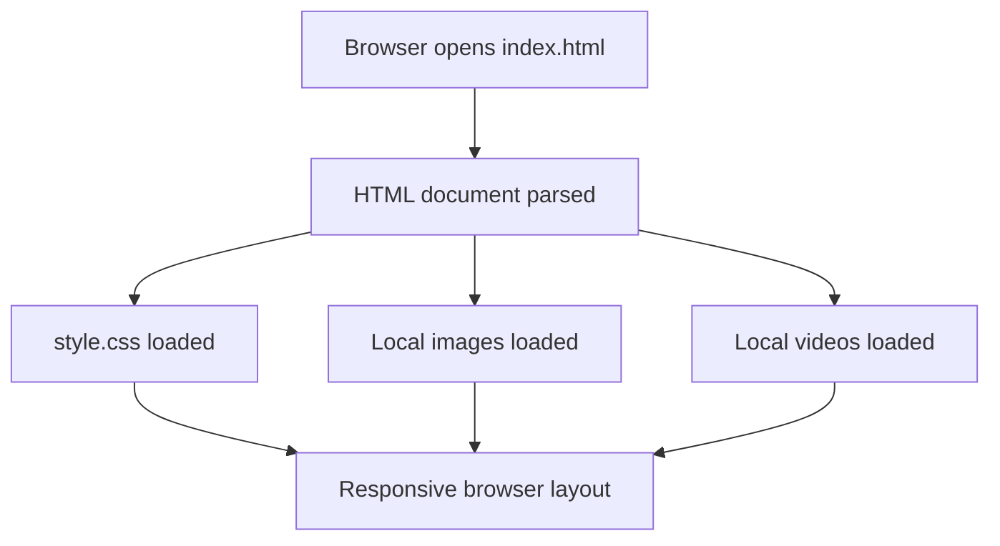

# Streaming Landing Page UI Recreation

An independent, static front-end learning project that recreates the visual structure of a subscription streaming landing page using **HTML5 and CSS3**. It is intended for practicing semantic markup, layout composition, typography, responsive styling, and local media handling.

> **Unofficial educational project.** This repository is not affiliated with, endorsed by, or sponsored by Netflix. It does not provide streaming, membership, authentication, billing, account management, or access to any streaming service.

<p align="center">
  
  
  
  
</p>

## Included page sections
- Dark hero area with navigation and a prominent call-to-action.
- Television, offline download, multi-device, and kids-profile feature sections.
- Decorative local video elements layered with image assets.
- Static FAQ-style rows and footer navigation.
- Responsive CSS breakpoints for desktop, tablet, and smaller screens.

## What is not included

The visible language selector, sign-in button, email fields, start buttons, FAQ rows, and download indicator are presentation-only. There is no JavaScript application, server, form handler, email delivery, user database, authentication, payment integration, content catalogue, or streaming service. Do not enter real credentials or personal information into the visual placeholders.

## Technology

| Area | Implementation |
|---|---|
| Markup | HTML5 |
| Styling | CSS3, Flexbox, Grid, media queries |
| Media | Local images and MP4 video files |
| Runtime | Modern web browser |
| Build tooling | None required |
| Automated checks | Python standard library and GitHub Actions |

## Run locally

No Node.js, package manager, build step, or dependency installation is required.

### Open directly
Open `index.html` in a modern browser. Some browser configurations restrict media behavior when a file is opened directly, so a local server is more reliable.

### Python static server
From the repository root:

```bash
python -m http.server 8000
```

Then visit [http://localhost:8000](http://localhost:8000). Stop the server with Ctrl+C.

## Repository structure

```text
.
├── .github/
│   ├── ISSUE_TEMPLATE/
│   ├── workflows/quality.yml
│   └── PULL_REQUEST_TEMPLATE.md
├── docs/
│   ├── ACCESSIBILITY.md
│   ├── ARCHITECTURE.md
│   ├── ASSET-INVENTORY.md
│   ├── DEPLOYMENT.md
│   ├── DEVELOPMENT.md
│   ├── LIMITATIONS.md
│   ├── ROADMAP.md
│   ├── TESTING.md
│   └── TROUBLESHOOTING.md
├── images/
├── scripts/validate_site.py
├── video/
├── index.html
├── style.css
├── CONTRIBUTING.md
├── CODE_OF_CONDUCT.md
├── SECURITY.md
└── LICENSE
```

## Rendering model



## Quality checks

Run the local validator:

```bash
python scripts/validate_site.py
```

It checks required files and local resource references. It does not replace browser testing, HTML conformance validation, accessibility testing, or visual review. GitHub Actions runs this check on pushes and pull requests targeting `main`.

## Documentation
- [Architecture](docs/ARCHITECTURE.md)
- [Development](docs/DEVELOPMENT.md)
- [Asset inventory](docs/ASSET-INVENTORY.md)
- [Accessibility](docs/ACCESSIBILITY.md)
- [Testing](docs/TESTING.md)
- [Deployment](docs/DEPLOYMENT.md)
- [Known limitations](docs/LIMITATIONS.md)
- [Troubleshooting](docs/TROUBLESHOOTING.md)
- [Roadmap](docs/ROADMAP.md)
- [Contributing](CONTRIBUTING.md)
- [Support](SUPPORT.md)
- [Security policy](SECURITY.md)
- [Community standards](CODE_OF_CONDUCT.md)

## Brand and asset notice

Third-party names, logos, artwork, and media remain the property of their respective owners. The repository's MIT license applies to original project source code only. It does not grant rights to third-party marks or assets. Review asset ownership and permissions before redistribution or public deployment.

## License

Original source code is provided under the MIT License. See [LICENSE](LICENSE). Third-party assets are not relicensed by that document.
