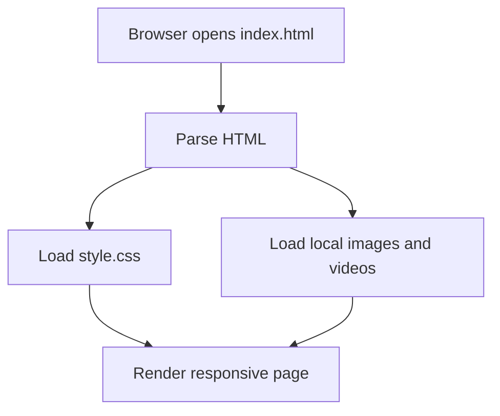

# Architecture

This project is a static browser page. It has no application server or client-side JavaScript runtime.

## Files

- `index.html`: page sections, navigation, local media references, and SEO/social metadata.
- `style.css`: layout, colors, typography, responsive behavior, and visual effects.
- `images/`: image assets referenced by the page.
- `video/`: decorative video assets used in feature sections.

## Rendering flow

The email fields and buttons are visual placeholders. No form submission, authentication, subscription, or streaming functionality is implemented.
